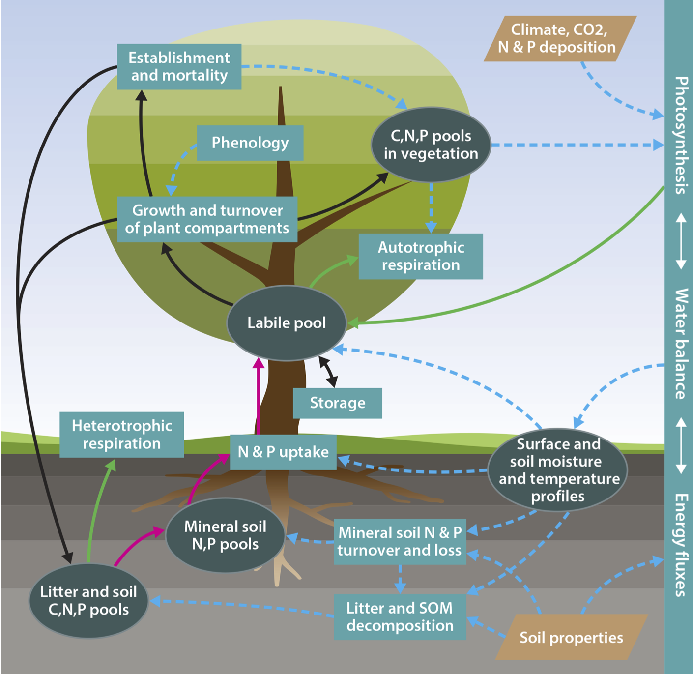

### The QUINCY model 

<figure>
  
  <figcaption> Fig 1: Schematic representation of biogeochemical, water and energy flows in QUINCY; as published in Thum et al. 2019</figcaption>
</figure>

@note
**QUINCY (QUantifying Interactions between terrestrial Nutrient CYcles and the climate system) v1** (Thum et al. 2019) has been developed to include a consistent representation of element cycling (in terms of carbon (C), nitrogen (N), and phosphorus (P)) in terrestrial ecosystems, as well as their interaction with the terrestrial water and energy balance suitable for the modelling of land-atmosphere interactions (<a href="fig_quincy_schematic">[Fig. 1]</a>). QUINCY was originally described by Thum et al. (2019) as a stand-alone ecosystem model, but has now integrated into the ICON-Land infrastructure and shares its physical process representation as well as the software infrastructure. It follows a modular structure to facilitate the consistent testing of multiple hypothesis for one particular process. This page gives a broad overview of model features, whereas the detailed description can be found [here](./quincy_long_description.html). 
---  
 
### Vegetation processes

Vegetation is characterised by an average individual representative of a
plant functional type (PFT). The model considers
eight broadly defined PFTs (see Tab.
<a href="./quincy_long_description.html#tab_pft_list">[Table: A1]</a>), representing
different leaf types (herbaceous, broadleaved, coniferous),
phenology (evergreen, rain green, and summer green), as well as growth
form (grasses and trees), with a set of traits describing time-invariant
functional differences across types (see Tab.
<a href="./quincy_long_description.html#tab_lctlib">[Table A2]</a>.
Different to other TBMs, certain "soft" plant functional type
characteristics, such as the photosynthetic capacity of leaves or the
temperature sensitivity of photosynthesis and respiration acclimate to
local conditions, and therefore lead to a smoother transition of
ecosystem functioning across eco-climatic gradients. 

Each vegetation type is described by three fast-lived structural tissue types (pools:
leaves, fine roots, fruits, and for herbaceous PFTs a straw pool), a respiring non-structural pool
(labile), as well as a seasonal, non-respiring, and non-structural
storage pool (reserve). In the case of tree vegetation types, three
longer-lived structural tissue types (sapwood, heartwood, and coarse
roots) are represented in addition, as are stand characteristics
(height, diameter, individual density).

Plant growth is modelled as the balance of source processes
(photosynthesis, nutrient uptake) and the capacity of the plant to
create sinks (production of new biomass tissue, respiration, and
storage; see Section <a href="./quincy_long_description.html#sec_growth">
[Plant Growth]</a>). The capacity of the plant
to generate sinks is dependent on *(i)* the activity of the plant’s
meristem controlling the usage of the labile pool for growth, which
becomes reduced at low air temperature and/or soil moisture; *(ii)* the
partitioning of its labile resource to new tissue growth and the
availability of nutrients to create these tissues; *(iii)* the need for
longer-term storage production; and *(iv*)* respiration for maintenance,
which is given priority over growth of new tissue.

Photosynthesis is calculated for sunlit and shaded leaves separately,
explicitly taking account of the vertical canopy gradient of light,
foliar chlorophyll and photosynthetic N according to (Kull and Kruijt
1998), with extensions for C4 photosynthesis (Friend et al. 2009), and
the temperature response as in (Bernacchi et al. 2001) (see Section
<a href="./quincy_long_description.html#sec_assimi">[Assimilation]</a>). 
The stomatal conductance is coupled to the calculation of photosynthesis 
according to the USO formulation (Medlyn et al. 2011; Knauer, Werner, and Zaehle
2015). Maintenance respiration is calculated for each tissue type as a
function of its N content and tissue temperature(Lloyd and Taylor, 1994, see Section
<a href="./quincy_long_description.html#sec_maintresp">[Maintenance Respiration]</a>). 
Photosynthesis and respiration optima acclimate to growth temperature according to 
(Friend 2010) and (Atkin, Meir, and Turnbull 2014), respectively.

Plant nutrient uptake is dependent on fine root biomass density, soil
soluble nutrient concentrations, temperature and moisture as well as 
plant internal nutrient demand (Zaehle and Friend, 2010; see Section 
<a href="./quincy_long_description.html#sec_plantnutrientuptake">[Plant Nutrient Uptake]</a>). 
Tissue growth follows a set of allometric equations describing 
size-dependent relationships of foliar, fine root, coarse root, sapwood and 
fruit biomass (see Section <a href="./quincy_long_description.html#sec_allocation">
[Plant Allocation]</a>). The allometric relationship between leaves and fine root responds to N, P
and water limitation and therefore increases uptake capacity under
nutrient limitation.

The allometric equations and the N and P content of each tissue give the
stoichiometric constraint of plant growth. The C:N and N:P ratios of the
leaves and fine roots are flexible within empirical bounds and respond
dynamically to an imbalance between C and N, or N and P availability,
respectively (see Section <a href="./quincy_long_description.html#sec_stoichiometry"> 
[Stoichiometry]</a>). Photosynthesis can be down-regulated through sink-limitation (see Sect.
 <a href="./quincy_long_description.html#sec_sinklimitation">[Sink Limitation]</a>), if nutrient
shortage leads to the accumulation of carbon in the labile pool.

Short-term fluctuations in the balance between carbon acquisition
through photosynthesis and nutrient acquisition by roots are balanced by
the time-scale of the labile pool turnover. Seasonal and longer-term
fluctuations are balanced to some extend by the build-up and use of the
reserve pool. The flow of compounds between the labile and reserve pools
(see Section <a href="./quincy_long_description.html#sec_reservepool"> 
[Reserve Pool Dynamics]</a>) is described by a set of pull 
(from the reserve pool) and push (to the reserve pool) mechanisms attempting 
to simulate the signaling related to the beginning
of the growing season (phenological pull), the need for maintenance and
growth (maintenance pull), as well as to provide resources for the next
growing season or resilience against interannual variability (reserve
push).

Turnover is considered at two time-scales: *(i)* the rapid breakdown of
enzymes (N) and associated RNA (P) from tissue, and their ensuing
replacement from the labile N and P pools (recycling; at the time scale
of days; Zaehle and Friend, 2010); and *(ii)* the senescence of entire
tissues and their conversion to litter, including the resorption of
nutrients from foliage (see Sect. <a href="./quincy_long_description.html#sec_plantturnover"> 
[Vegetation Turnover]</a>). Tissue senescence is calculated given a fixed 
turnover time for each tissue, with the exception of the leaves and fine roots, where 
turnover is determined by the PFT-specific phenological timing
(see Section <a href="./quincy_long_description.html#sec_phenology"> 
[Phenology]</a>). 

Stand-level vegetation dynamics (see Section <a href="./quincy_long_description.html#sec_vegdynamics"> 
[Vegetation Dynamics]</a>) are represented through density-dependent mortality, as well as a dynamic
background mortality related to the overall growth efficiency of the
plant (Sitch et al. 2003; Zaehle and Friend 2010). Re-establishment of
vegetation depends directly on the past vegetation ability to produce
fruits, as the re-establishment is explicitly taking account of the
available seed pool at the forest / grassland floor.

### Soil hydrological and biogeochemical processes

The vertical soil profile of physical and biogeochemical processes is
explicitly represented, with exponentially increasing layer thickness
with increasing soil depth. For each soil layer, temperature and moisture are calculated based on
soil physical characteristics, and the transport and atmospheric
exchange of energy and water (see Section <a href="./quincy_long_description.html#sec_soilhydrology"> 
[Soil Hydrology]</a>). For each soil layer, the model
represents different organic pools (metabolic, structural, and woody
litter, as well as fast and slow overturning soil organic matter (SOM)),
as well as inorganic pools of N and P (soluble and minerally-absorbed 
NH4, soluble NO3 as well as soluble minerally-adsorbed, 
occluded and primary PO4). 

The turnover and formation of SOM follows, with some modifications, the
CENTURY approach (Parton et al. 1993) (see Section <a href="./quincy_long_description.html#sec_soilBGC"> 
[Soil Biogeochemistry]</a>): The turnover
of litter and SOM pools are all calculated using first-order kinetics
with temperature and moisture dependence. The litter stoichiometry is
determined by the stoichiometry of senescent plant tissue and
tissue-specific allocation fractions. The stoichiometry of the fast SOM
pool adjusts to available inorganic nutrients, whereas the slow SOM pool
is assumed to have fixed C:N:P stoichiometry.

The soluble inorganic pools (NH4, NO3 and PO4) and are assumed to be available for plant and
microbial uptake, as concluded by White (2006) and many others. Plants
and soil microbes compete for these nutrients based on their respective
demand and uptake capacity, which varies in time and with soil depth. In
the aerobic part of soil, NH4 is oxidised to through nitrification and in
anaerobic part of soil, NO3is reduced to through denitrification (Zaehle et
al. 2011). Both processes produce NOx, N2O and N2 as by-products (see Section <a href="./quincy_long_description.html#sec_denitrification">
[Nitrification and Denitrification Processes]</a>). 

The representation of soil inorganic P dynamics (see Section <a href="./quincy_long_description.html#sec_pdynamics">
[Soil P Processes]</a>) follow the concept
from (Yang et al. 2014) and (Wang, Law, and Pak 2010). The available
soluable is exchanged via ad-/desorption with the mineral surface,
leached with soil water, and replenished by atmospheric deposition,
weathering, and biomineralisation of P that is bound in the slow SOM
pool. The adsorbed P is further absorbed into the soil matrix and
gradually becomes an inactive form of P, occluded P, as proposed by
(Walker and Syers 1976).

### Driving data

QUINCY requires hourly short- and longwave downward radiation, 2m air temperature, precipitation and snowfall, wind
velocity, atmospheric humidity and CO2 mole fractions, as well as rates of NH4, NO3, and PO4 deposition as time-dependent driving data. In addition, the model
requires input describing the geographical coordinates, vegetation type,
and soil physical and chemical parameters (texture, bulk density,
rooting and soil depth, as well as inorganic soil P content).

### Literature

Atkin, Owen K., Patrick Meir, and Matthew H. Turnbull. 2014. “Improving
Representation of Leaf Respiration in Large-Scale Predictive
Climate–Vegetation Models.” *New Phytologist* 202 (3): 743–48.
<https://doi.org/10.1111/nph.12686>.

Bernacchi, C J, E L Singsaas, C Pimentel, A R Protis JR, and S P Long.
2001. “Improved temperature response functions for
models of Rubisco-limited photosynthesis.” *Plant, Cell &
Environment* 24 (January): 253–59.

Friend, Andrew D. 2010. “Terrestrial plant
production and climate change.” *Journal of Experimental Botany*
61 (5): 1293–1309.

Friend, Andrew D, R J Geider, M J Behrenfeld, and C J Still. 2009.
“Photosynthesis in Global-Scale Models.” In
*Photosynthesis in Silico: Understanding Complexity from Molecules to
Ecosystems*, edited by A Laisk, L Nedbal, and Govindjee, 465–97.
Springer.

Knauer, Jürgen, Christiane Werner, and Sönke Zaehle. 2015.
“Evaluating stomatal models and their atmospheric
drought response in a land surface scheme: A multibiome
analysis.” *Journal of Geophysical Research: Biogeosciences* 120
(10): 1894–1911.

Kull, O, and B Kruijt. 1998. “Leaf photosynthetic
light response: a mechanistic model for scaling photosynthesis to leaves
and canopies.” *Functional Ecology* 12 (5): 767–77.

Lloyd, John, and J A Taylor. 1994. “On the Temperature Dependence of
Soil Respiration.” *Functional Ecology*, 315–23.
<https://www.jstor.org/stable/2389824>.

Medlyn, B.E., Duursma, R.A., Eamus, D., Ellsworth, D.S., Prentice, I.C., Barton, C.V.M., Crous, K.Y., De Angelis, P., Freeman, M., and Wingate, L., 2011. “Reconciling the optimal and empirical approaches to modelling stomatal conductance.”. *Global Change Biology*, 17: 2134–2144. doi:10.1111/j.1365-2486.2010.02375.x

Parton, W J, J M O Scurlock, D S Ojima, T G Gilmanov, R J Scholes, D S
Schimmel, T Kirchner, et al. 1993. “Observations
and modelling of biomass and soil organic matter dynamics for the
grassland biome worldwide.” *Global Biogeochemical Cycles* 7 (4):
785–809.

Sitch, Stephen A, Benjamin Smith, I C Prentice, Almut Arneth, Alberte
Bondeau, W Cramer, J O Kaplan, et al. 2003.
“Evaluation of ecosystem dynamics, plant geography
and terrestrial carbon cycling in the LPJ Dynamic Global Vegetation
Model.” *Global Change Biology* 9: 161–85.

Walker, T. W., and J. K. Syers. 1976. “The Fate of Phosphorus During
Pedogenesis.” Journal Article. *Geoderma* 15 (1): 1–19.
<https://doi.org/10.1016/0016-7061(76)90066-5>.

Wang, Y P, R M Law, and B Pak. 2010. “A global
model of carbon, nitrogen and phosphorus cycles for the terrestrial
biosphere.” *Biogeosciences* 7 (7): 2261–82.

White, Robert E. 2006. *Principles and Practice of Soil Science the Soil
as a Natural Resource*. Book. 4th ed. Vol. 32. Malden: Blackwell
Publishing. <https://doi.org/10.1177/0340035206070163>.

Yang, X., P. E. Thornton, D. M. Ricciuto, and W. M. Post. 2014. “The
Role of Phosphorus Dynamics in Tropical Forests – a Modeling Study Using
CLM-CNP.” *Biogeosciences* 11 (6): 1667–81.
<https://doi.org/10.5194/bg-11-1667-2014>.

Zaehle, S, Philippe Ciais, Andrew D Friend, and Vincent Prieur. 2011.
“Carbon benefits of anthropogenic reactive nitrogen
offset by nitrous oxide emissions.” *Nature Geoscience* 4 (8):
601–5.

Zaehle, S, and Andrew D Friend. 2010. “Carbon and
nitrogen cycle dynamics in the O-CN land surface model: 1. Model
description, site-scale evaluation, and sensitivity to parameter
estimates.” *Global Biogeochemical Cycles* 24 (1): GB 1005.