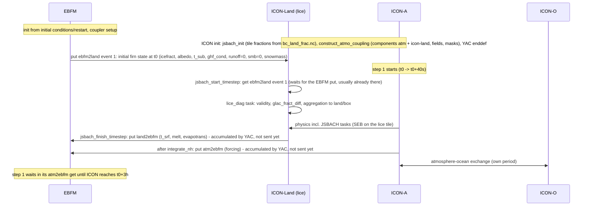
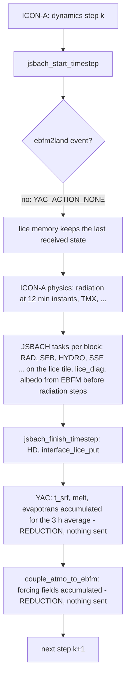
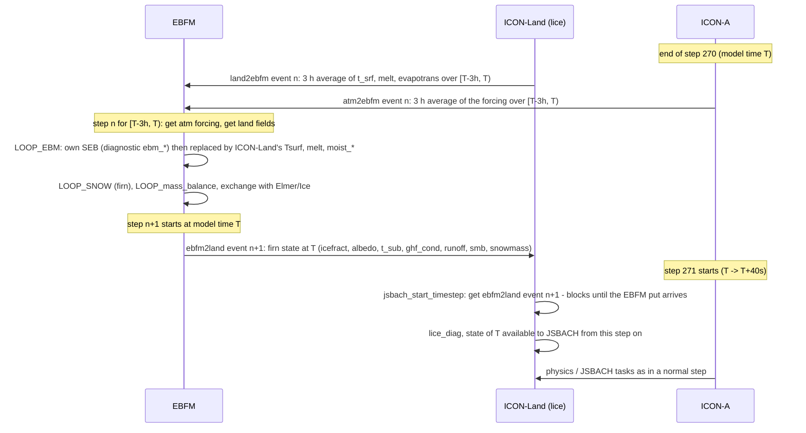

# Coupling of ICON-A, ICON-Land (JSBACH) and EBFM

> Technical reference. For a science-focused description of the coupling (EBFM's surface energy
> balance and firn physics, what is exchanged and why, the Elmer/Ice side), see
> [ebfm_icon_land_science.md](https://gitlab.dkrz.de/jsbach/jsbach/-/blob/feature/ebfm-coupling/docs/ebfm_icon_land_science.md).
>
> Paths `mkexp_configs/...` and `elmer_scripts/...` refer to the TerraDT experiment repository
> [mkexp_coupled_experiments](https://gitlab.dkrz.de/m300792/mkexp_coupled_experiments/-/tree/ebfm_jsbach_coupling) (branch `ebfm_jsbach_coupling`).

This document describes the coupling strategy between the ICON atmosphere (ICON-A), the land model
ICON-Land (JSBACH, running as part of the ICON-A physics) and the firn model EBFM via YAC.
The ocean (ICON-O) and Elmer/Ice are only mentioned where they affect the sequence.

Numbers in the examples refer to the R2B4 test setup: ICON time step 40 s, radiation time step 12 min,
EBFM time step = coupling period 3 h (270 ICON steps).

## Components and roles

| model | YAC component | runs on | time step |
|---|---|---|---|
| ICON-A | `atm` | atmosphere MPI ranks | 40 s |
| ICON-Land (JSBACH) | `icon-land` (predefined with YAC by `jsb_construct_coupling` in `mo_jsb_coupling` before ICON-A defines its own components in `cpl_def_main`, which completes the definition; same grid and cell points as `atm`) | atmosphere MPI ranks, called from the ICON-A physics every step | 40 s |
| EBFM | `ebfm` (one component for all its partners, internal "components" `icon_atmo`, `icon_land`, `elmer_ice`) | own rank(s), Elmer mesh | 3 h |

Division of labour on ice-covered cells (decided 2026-08-22):

* **ICON-Land computes the surface energy balance (SEB) of the `lice` tile every ICON time step**
  (TMX: semi-explicit coupling to the atmosphere, SEB/TURB/HYDRO/SSE run per tile), because the
  surface fluxes and the radiative properties seen by the atmosphere depend on it.
* **EBFM keeps the snow/firn model** (heat conduction, percolation, refreezing, densification,
  runoff) and the mass balance. It no longer solves its own SEB when coupled (it still evaluates it
  as a diagnostic, `ebm_*`). Surface melt is thus *produced* by ICON-Land's SEB and sent to EBFM,
  which decides what becomes of the melt water; the reasoning is given in the science description
  ("Why melt is computed by ICON-Land and not by EBFM").
* EBFM is conceptually "the glacier tile engine" of ICON-Land: it provides the surface/firn
  *state*, ICON-Land computes the *fluxes* from it. This is the same pattern as the ICON
  atmosphere-ocean coupling (ocean provides SST, atmosphere computes fluxes).

In ICON-Land the coupling is implemented by the process `lice` (land ice, `jsb_lice_nml`), which
runs `ON_TILE_` on a dedicated tile `lice`; its variables are aggregated to the `land` and `box`
tiles. The YAC glue lives in `externals/jsbach/src/lice/mo_interface_lice_ebfm.f90`.

### The `lice` tile

EBFM covers only part of ICON-Land's land ice (Greenland), while the glacier tile `glac` represents
land ice everywhere (Antarctica, mountain glaciers). Therefore the EBFM-coupled ice is a **second
glacier tile** `lice`, a sibling of `glac` and `veg` below `land` with the same land cover type
`GLACIER_TYPE`: every process treats it as a glacier (same physics, memory, restart and output, with
the tile suffix `_lice`), and the EBFM-specific branches in the processes are selected by
`tile%Is_process_calculated(LICE_)`, i.e. only on `lice`. The tile is created in the TMX usecases
(`jsbach_lite`, `jsbach_pfts`) when the `lice` process is active.

Its fraction `fract_lice` (relative to the land tile) is read from `bc_land_frac.nc` like all tile
fractions, with `fract_glac` reduced to the glaciers outside the EBFM domain and
`fract_veg = 1 - fract_glac - fract_lice`. Inside the Elmer/EBFM mesh the ice sheet model is
authoritative (no JSBACH glacier there). The fractions are produced by
[`elmer_scripts/lice_fractions.py`](https://gitlab.dkrz.de/m300792/mkexp_coupled_experiments/-/blob/ebfm_jsbach_coupling/elmer_scripts/lice_fractions.py) (one-off, e.g. for runs without Elmer/Ice, from the ice thickness
of the Elmer XIOS restart with the EBFM definition `h > 1 m`) and by [`elmer_scripts/postprocess_elmer.py`](https://gitlab.dkrz.de/m300792/mkexp_coupled_experiments/-/blob/ebfm_jsbach_coupling/elmer_scripts/postprocess_elmer.py)
after every run chunk (from Elmer's `sftgif`; `--no-lice-tile` restores the old single-glacier-tile
files). They are conservative area fractions (CDO `genycon` with `CDO_REMAP_NORM=destarea`, the
same normalisation as YAC's `icefract`; requires CDO >= 2.6, older versions ignore `destarea` - the
generated weights are checked): `cov` = part of the ICON cell covered by the mesh, `ice` =
part covered by ice-covered mesh cells; relative to the land tile (`land_abs = notsea * fract_land`):
`fract_lice = ice / land_abs`, `fract_glac = (1 - cov / land_abs) * fract_glac_master`,
`fract_veg = 1 - fract_glac - fract_lice` (all clipped to [0, 1]). The nearest-neighbour 0/1
variant of the old post-processing is available with `--method nn`. The ice fraction `icefract` received from EBFM at run time is a consistency diagnostic
(`lice_glac_fract_diff`) until dynamic tile fractions are implemented.

#### Generating the fraction file for a grid

`lice_fractions.py` has no resolution setting of its own - the target resolution is defined
entirely by two inputs, which must be on the **same ICON grid**:

* `--icon-grid`: the target grid file. The CDO weights (Elmer mesh -> this grid) are generated for
  exactly its cells; the Elmer side (`--elmer-file`, static mesh) is resolution-independent.
* `--master`: the `bc_land_frac` file **for that same grid**. The output is a modified copy of it
  (`fract_glac`/`fract_veg` rewritten, `fract_lice` added), so it inherits the master's grid and
  all other variables - for a `jsbach_pfts` setup use the 12pfts master, so the PFT fractions are
  carried along. There is no explicit consistency check between master and grid; a mismatch fails
  with a CDO/NCO dimension error rather than silently.

The `--workdir` caches the Elmer grid description and the remap weights under fixed names
(no resolution tag) - use a **separate workdir per ICON grid**. `destarea` weights need
**CDO >= 2.6** (e.g. `module load cdo/2.6.0-gcc-11.2.0`); the script checks the generated weights
and aborts on older versions, which silently fall back to `fracarea`. Weight generation is a
one-off per grid (cached; expect it to take considerably longer at R2B8 than at R2B4).

Example for the R2B4 test configs (`jsbach_lite`, grid 0049, master from the `AES/coupled-R02B04L90`
land input):

```bash
elmer_scripts/lice_fractions.py \
    --elmer-file /work/bm1514/data/elmer-xios-output/restart.nc \
    --master /pool/data/ICON/grids/public/mpim/0049-0036/land/r0100/bc_land_frac.nc \
    --icon-grid /pool/data/ICON/grids/public/mpim/0049/icon_grid_0049_R02B04_G.nc \
    --workdir <scratch>/lice_fract \
    --out <scratch>/lice_fract/bc_land_frac_lice.nc
```

Example for the high-res R2B8-R2B9 config (`jsbach_pfts`, grid 0054, 12pfts master, reference
year 1990 - see `terradt-R2B8_R2B9`):

```bash
elmer_scripts/lice_fractions.py \
    --elmer-file /work/bm1514/data/elmer-xios-output/restart.nc \
    --master /pool/data/ICON/grids/public/mpim/0054-0016/land/r0101/bc_land_frac_12pfts_1990.nc \
    --icon-grid /pool/data/ICON/grids/public/mpim/0054/icon_grid_0054_R02B08_G.nc \
    --workdir <scratch>/lice_fract_R2B8 \
    --out <scratch>/lice_fract_R2B8/bc_land_frac_lice_12pfts.nc
```

Point `BC_LAND_FRAC_LICE` in the mkexp config to the output; the run scripts link it as
`bc_land_frac.nc` for the first chunk (later chunks of the transient setups come from
`postprocess_elmer.py`). Defaults: EBFM's ice definition `h_elem > 1 m` (`--mask-from h_elem`,
alternatively `sftgif`), `--method conservative`, 16 CDO threads (`--nprocs`).

### The EBFM mesh, its ice mask and ice-free cells (facts, open questions)

Established 2026-08-23 from the Elmer XIOS restart file and the EBFM code (to be discussed with the
EBFM developers):

* The Elmer/EBFM mesh is **static** and covers essentially **all of Greenland** (372 241 cells,
  2.06 x 10^6 km^2, vs. 2.17 x 10^6 km^2 for Greenland), ice-covered or not: 1.78 x 10^6 km^2 have an ice
  thickness > 1 m (the ice sheet), 60 787 mesh cells are ice-free. Only ice thickness, surface
  elevation and the ice mask `sftgif` evolve on it. The mesh coverage used for `fract_lice`
  (`cov`) is therefore the fixed Greenland domain; only its ice-covered part changes with time.
* EBFM's ice mask (`grid["mask"] = h > 1 m`) is set **once at initialisation** (`INIT.py`) and is
  not updated during a run; the surface elevation received from Elmer only updates the elevation.
  Hence `icefract` sent to ICON-Land is a snapshot of the initial ice mask and does not follow
  ice retreat/advance within a run.
* EBFM runs its firn model (and energy balance) on **all** mesh cells, ice-free ones included
  (same initial firn column, bare-ice albedo); the mask is only used for diagnostics, the
  "double depth" layering and `icefract`.

Consequences for the coupling: the fraction files are derived from Elmer's ice mask/thickness at
the chunk boundaries (post-processing), independent of EBFM's frozen mask, so the `lice` tile
fraction follows the ice sheet; ice-free Greenland cells are vegetation in ICON-Land (never the
JSBACH glacier tile `glac`). Open questions: should EBFM update its mask from Elmer's thickness
every step (and stop sending `smb`/`runoff` as ice for ice-free cells), and how should newly
ice-free/ice-covered cells be initialised on both sides?

### Restarts

Restart legs work (verified 2026-08-23 with a 2-day `coupled_ebfm` run, restart after day 1):
ICON restarts bit-exact from the multifile restart, which carries all `lice` process variables
(incl. `hcap_sub`) and - with SSE off on the lice tile - no SSE variables for that tile; the
surface temperature evolves smoothly across the restart boundary. The EBFM command in the mpmd
configuration takes its `--start-time`/`--end-time` from the leg dates
(`${start_date_ebfm}`/`${end_date_ebfm}`, defined per leg in the run templates), so every leg
launches EBFM over the correct interval. **EBFM restarts** (since 2026-08-24): the
`coupled_ebfm(_elmer)` setups pass `--restart-dir ${ebfm_restart_dir}` (a persistent directory
`ebfm_restart/` next to `work/`, defined per leg in the run templates) - the first leg only
writes, continuation legs also pass `--restart-init` and read `restart_<start>.nc` - so the firn
state survives restart legs (verified: `t_sub` continuous across the leg boundary; note that only
*partitioned* EBFM runs cannot write restarts). Two sharp edges: the restart files are large
(~0.9 GB per leg at the Greenland mesh, one file per leg, no automatic cleanup), and EBFM refuses
to overwrite an existing restart file - re-running a leg requires deleting its
`restart_<end>.nc` first.

### EBFM output

EBFM output is enabled in coupled runs (2026-08-24; previously it was skipped): every leg writes
`Output/model_output.nc` in its run directory - daily records (`freqout = 8` at a 3 h step) of the
forcing, the diagnostic energy balance (incl. `ebm_Tsurf`/`ebm_melt`/`ebm_Emelt` next to the
ICON-Land-driven `Tsurf`/`melt`), the firn/mass-balance fields and the `sub*` profiles, on the
unstructured Elmer mesh with `lat`/`lon` coordinate variables (CF `coordinates` attribute). The
tile fractions of ICON-Land (`group:jsb_tile_fractions`, incl. `fract_lice`) are written once per
experiment (a single snapshot at `$INITIAL_DATE`) to the separate stream `lnd_fract_2d_inst` for
evaluation (e.g. weighting per-tile variables) - the fractions are constant, and the files carry
no time axis, so per-leg files would collide in the intake catalog (identical keys).

## Exchanged fields

| couple | direction | fields | YAC settings |
|---|---|---|---|
| `atm2ebfm` | ICON-A -> EBFM | `tas`, `sfcwind`, `pr_snow`, `pr`, `rsds`, `rlds`, `clt`, `sfcpres`, `huss` (forcing) | PT3H, `average`, `src_lag 1`, `tgt_lag 1`, 1-nn |
| `ebfm2land` | EBFM -> ICON-Land | `icefract` (ice-covered fraction of the ICON cell), `albedo`, `t_sub` (first firn layer temperature), `ghf_cond` (conductance surface-first layer), `hcap_sub` (heat capacity of the firn surface layer), `runoff`, `smb`, `snowmass` (EBFM's source names are `runoff_to_icon_land` and `smb_to_icon_land`, mapped to the ICON-Land names with `src:`/`tgt:` in `coupling.yaml`: YAC requires unique source field names per component and EBFM sends `runoff_to_elmer`/`smb_to_elmer` to Elmer/Ice) | PT3H, `none`, `src_lag 0`, `tgt_lag 0`, conservative; ICON-Land missing value (state) or 0 (mass) where EBFM has no data |
| `land2ebfm` | ICON-Land -> EBFM | `t_srf`, `melt`, `evapotrans` (negative upward) of the `lice` tile | PT3H, `average`, `src_lag 1`, `tgt_lag 1`, 1-nn, YAC source mask `fract_lice > 0` |

Conventions: fluxes positive into the surface in both models; ICON-Land sends kg m-2 s-1,
EBFM converts to m w.e. per time step; EBFM sends its mass fields per unit ice area.

## Timing

YAC matches the n-th put event of the source with the n-th get event of the target. Each side
advances its own event clock with every put/get call, pre-advanced by `lag x own time step`, and
an event fires when the clock is a multiple of the coupling period.

* `atm2ebfm` / `land2ebfm` (lag 1/1): ICON puts after every step (stamped with the end-of-step
  time); YAC averages over the 3 h period and sends at the period boundary. EBFM's get in its step
  for [T, T+3h) receives the **average over [T, T+3h)**, which is available when ICON reaches T+3h.
  EBFM therefore runs one coupling period behind ICON, but with the forcing of exactly its own
  interval.
* `ebfm2land` (lag 0/0): EBFM puts the state valid at T at the start of its step; ICON-Land gets it
  in `jsbach_start_timestep` of the ICON step starting at T, i.e. **the state of instant T is used
  from T on, also in the very first step**. The price: at every coupling instant ICON waits until
  EBFM has finished its step (EBFM is on the critical path). This costs one EBFM step (about 17 s at
  R2B4 on one rank) per coupling period, independent of ICON's resolution, i.e. negligible at
  production resolution. A one-period target lag (ICON-Land using the state 3 h late, no waiting,
  as in ICON's atmosphere-ocean coupling) was available as an option for cheap tests and was
  dropped: the first firn layer temperature and the albedo respond within hours, so a lagged state
  would degrade the ground heat flux and radiation feedback for a saving that does not matter.

### Very first time step of an experiment



### ICON-A / ICON-Land time step without a coupling event (e.g. step 2 ... 269)



### Coupling time step (ICON reaches T = n x 3 h, e.g. end of step 270 / start of step 271)



ICON-A/ICON-Land are therefore blocked for the duration of one EBFM step at every coupling instant
(about 17 s per 3 h at R2B4 with EBFM on one rank). Between coupling instants the models run
concurrently: ICON integrates the next 3 h while EBFM is idle (waiting for the next averages).

## Where the received fields are used in ICON-Land

| field | status |
|---|---|
| `icefract` | received, diagnostics only (`icefract_valid`, `glac_fract_diff` = `icefract - fract_lice`); changing `fract_lice` at run time needs the LCC framework (water conservation) - later |
| `albedo` | used in `update_albedo` (RAD) of the `lice` tile: EBFM's broadband albedo for both bands where EBFM provides data, JSBACH's glacier albedo otherwise (one step before each radiation step) |
| `t_sub`, `ghf_cond`, `hcap_sub` | `t_sub` additionally initialises the surface temperature of the lice tile at experiment start (in `interface_lice_get`, cold starts only): the SEB memory initval is a constant 280 K, which otherwise melts ~5 mm w.e. during the first coupling window while the surface relaxes. Used in the SEB of the `lice` tile: ground heat flux `ghf_cond * (t_sub - t_srf_old)` and surface-layer heat capacity `hcap_sub` replace SSE's `grnd_hflx`/`hcap_grnd`; **SSE is switched off (`SKIP_`) on the lice tile** (the firn energetics are EBFM's). Note: SSE variables with `l_aggregate_all` are diluted by the lice fraction in land/box aggregates (diagnostics only). |
| `runoff` | used as the `lice` tile runoff handed to the HD model (`hydro_runoff`), replacing the P - E that JSBACH uses on glacier tiles. The residual P + E - runoff (water stored in or released from the EBFM firn) is accumulated in the new storage variable `hydro_weq_firn` [m w.e.], which `update_water_balance` counts as land water, so the water-balance check stays exact on the lice tile and on the land/box aggregates. `weq_firn` is also a useful diagnostic: the ICON-Land-implied firn storage change, comparable with EBFM's `smb` (term-by-term explanation in the science description, "The firn storage variable `weq_firn`"). Note the water is no longer routed to the ocean immediately: accumulation stays in the firn until EBFM releases it (or, in the full system, until Elmer discharges it as ice). |
| `smb`, `snowmass` | received, diagnostics |

## Configuration

* `NAMELIST_atm`: `coupling_mode_nml` `coupled_to_ebfm = .TRUE.` (atm2ebfm) and
  `coupled_to_ebfm_land = .TRUE.` (registers the `icon-land` component and defines the lice fields)
* `NAMELIST_lnd`: `jsb_lice_nml` `active = .TRUE.`; optional `jsb_turb_nml` switches for the
  turbulent exchange of the lice tile (all default off): `roughness_lice` (own z0m, e.g. 1e-3 m),
  `l_rough_h_lice` (use the scalar roughness in the TMX exchange coefficients),
  `l_katabatic_lice` (EBFM's bulk katabatic closure for the scalar exchange); usecase `jsbach_lite` or `jsbach_pfts`, both
  with `use_tmx = .TRUE.` (the lice tile is part of both TMX usecases; the low-res test configs
  use `jsbach_lite`, the high-res R2B8-R2B9 config uses `jsbach_pfts`);
  `bc_land_frac.nc` must contain `fract_lice` (see above); `output_tiles = box, lice` for the tile values
* mkexp `[[coupling.yaml]]`: `include_ebfm_land = true`, `[[[land]]] name = icon-land`
* EBFM command line: `--couple-to-icon-atmo --couple-to-icon-land`
* Output of the lice variables: `output_nml` with `ml_varlist = group:jsb_lice_basic`
  (tiles according to `output_tiles` in `jsb_model_nml`, default `box`)

See [`mkexp_configs/coupled_ebfm.config`](https://gitlab.dkrz.de/m300792/mkexp_coupled_experiments/-/blob/ebfm_jsbach_coupling/mkexp_configs/coupled_ebfm.config) for a complete example.
