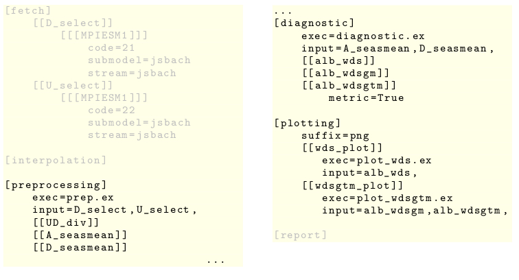

.. include:: defs.hrst

Participate
===========

**Yield**

* usability for your scientific question
* test your simulation output data
* influence the development of the tool
     

Introducing Features
-------------------

**Effort**

1. For a diagnostic field ...

   * determine the most significant analyses and benchmarks
   * write texts for the report
   * implement the processing chain: preprocessing, analysing, plotting
   * define the configurations files
   * make tests

2. for a simulation/observation type ...

   * locate sources of experiment data
   * index relevant variable output data
   * identify methods to extract it
   * characterize temporal and spatial structure
   * indentify interpolation methods

     

Diagnostic Fields
-----------------

**A diagnostic field ...**

* clusters scientific processing
* is defined by a specific configuration file
* provides at least one diagnostic method
* should supply a metric/benchmark
* is mapped to one section in the report

::

  [fields]
      [[albedo]]
          config_filename=albedo.cfg

**Listing:** main.cfg, example

	  
**Its configuration file defines ...**

* the field specific part of the interface and the associated scripts
* corresponding workflow
* keys/infixes for I/O interface
  

Configuration
-------------				   

**Listing:** albedo.cfg, example

I/O Dependencies
----------------

Following the link from the listing shown above leads to an illustration of the I/O deplendencies.

Processing
----------

**Scripts**

* each either for preprocessing, diagnostic or plotting
* work on local data, interpolated as indicated by user and modeltype
* layed out for one candidate and one reference experiment
* run by |b4j| in loops over multiple experiments
* interface has to be provided by the respective and the main
  configuration file concerning
  
  * input and output filenames and format
  * grid, spatial resolution, tiling and global fragmentation
  * time resolution and period
  * other
    
* called in order of I/O dependencies
* written in any programming language

