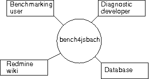

.. include:: defs.hrst

Introduction
============

Main idea
---------

With |b4j| we started developing a tool for the scientists of
the land department in the |mpi| to make the
comparison of |jsbach| model simulation output data [ReJSBA]_ with one another and with data
products straight forward and user friendly. In the first instance the tool
shall serve for the benchmarking of land models, it has to be able to quantify
the deviation of a simulation from reference experiments in the most crucial and/or
influential parameters out-of-the-box. This will help developing models
as well as managing a large number of them. It is desirable to cover most
research areas of the land department and to keep the tool well adapted
to the local technical conditions at the |mpi|.

In order to have a living, dynamical tool, the possibility for individual
extension is provided to the user from the beginning. This will help the
benchmarking process to
retain its validity but also help the scientists to handle future questions
bringing new values into focus. It may also foster the communication between
the groups as individual developments can easily be made usable for the
whole department and thus serve as a basis for a fruitful discussion on the most
significant diagnostic for the generally applicable benchmarking in the
department.

.. _concepts:

Concepts
--------

A guiding idea for |b4j| is the separation of issues that strongly depend on the
origin of the climate data from issues directly related to their
comparison. It is intended to solve the origin dependend tasks
'under the hood' of the tool so that a scientist can
focus on the diagnostic and benchmarking methods.

.. _exps:

Experiments
+++++++++++

We use the generic term :math:`\mathtt{experiment}` independent from the
data origin holding earth system model simulation output or 
observational data. Origin dependend processing like locating and extracting
necessary raw data from different host, filesystem and out of
datafile but also data interpolation are gathered under the name.

You may assign the role of a reference or that of a candidate to an |exp|, in a comparison
at least one instance of each is needed. It is possible to have multiple |exp| s and
also a single instance can take both roles in one |b4j| run. The main difference
of the roles is the comparison being made and the  report being written from
the perspective of the candidate |exp| s.
Depending on the evaluation method each candidate can be compared with single
references or with all references at once.

.. _diag-fs:

Diagnostic fields
+++++++++++++++++

The term |diag-f| clusters
processing  for the comparison of |exp| s with a defined set of variables
featuring a particular scientific question.
It should contain at least one diagnostic and one benchmarking method.  In this
context the term
benchmarking refers to a method that condenses the deviation of two
experiments to one number, i.e. yields a global and time average value for it.

Context
-------

The following diagram shows |b4j| in context with other actors ( users, software, ... ). 

   **Figure:** Context diagram of |b4j|

:Benchmarking user:     * scientist managing many models
                        * model developer making  still-in-line-check  
:Diagnostic developer:  dedicated scientist integrating a |diag-f|
:Database:              database for reference |exp| s
:Redmine wiki:          communication platform for |b4j|
			

Status
------

This documentation is based on a not yet tagged
version ( `0.0.1` ) of |b4j|, a vertical prototype. The basic 
operating concept, the program structure and the workflow is implemented. The
tool handles |exp| s of type  MPIESM1 (Max Planck
Institute for Meteorology Earth System Model, [GiESM1]_) and a |diag-f| analysing
albedo.
