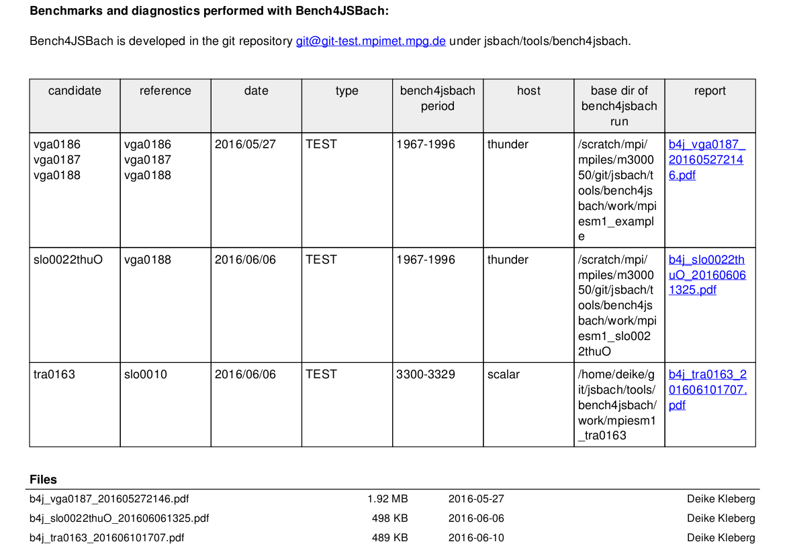
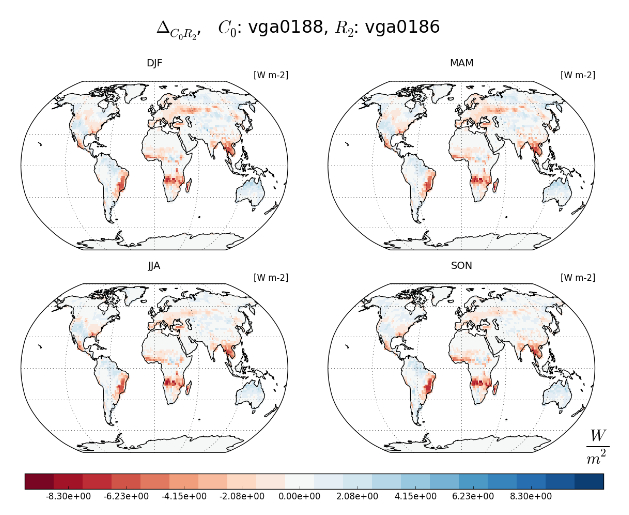
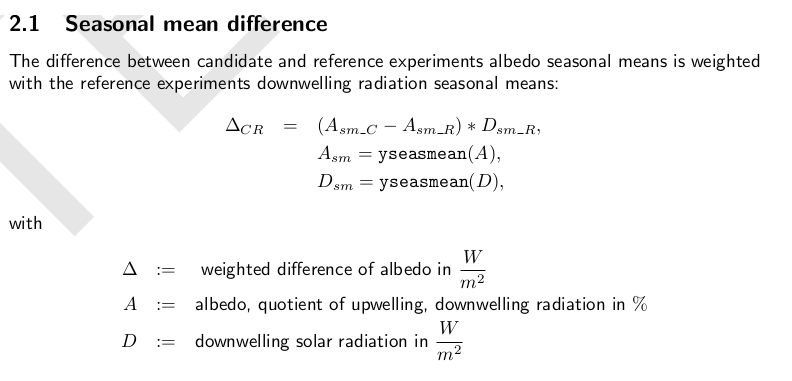
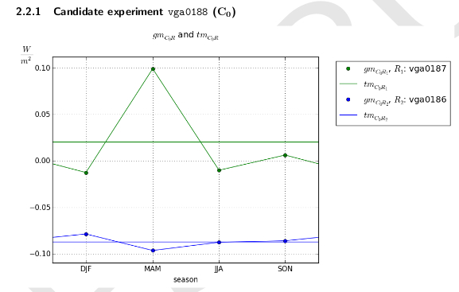
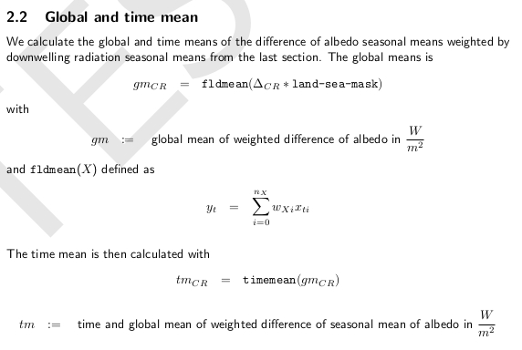
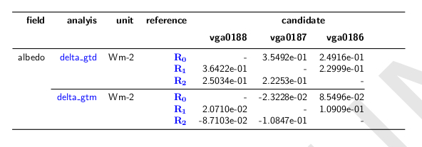

.. include:: defs.hrst

Report
======

Examples
--------
Examples of |b4j| generated reports can be found on the wikipage
|wiki|. To get an impression follow the link and open one of the listed reports.

   **Figure:** Detail from |wiki|
   

Structure
---------

The reports generated by  |b4j| contain three sections, introduction, main part and summary.

1. Introduction |br|
    This is the overall |b4j| run description. It consists of 
   
    a) all experiments table
    #) experiment subsections
      
        \i. table of metadata |br|
        \ii. description of special features |br|
	 
    #) all diagnostic fields table ( methods, benchmarks )
    #) system and runtime information
     

#. Main part |br|
    contains one section for each diagnostic field. They are structured as follows
   
    a) field description
    #) method subsections
      
        \i. scientific information |br|
        \ii. evaluation criteria for benchmarks |br| 
        \iii. technical information |br|
        \iv. presentation of results e.g. plots |br|

#. Summary |br|
    display of benchmark results from all diagnostic fields

Main Part
---------

The main part is grouped by the diagnostic fields and their methods. The methods are
scientifically and technically explained and evaluation criteria for the benchmarks
are supplied.

We have selected some extracts exemplarily.

   **Figure:** Example for difference plot of seasonal mean . 
   

   **Figure:** Example part of documentation of a diagnostic method.

   **Figure:** Example for difference plot of global and time mean for one candidate and two references. 

   **Figure:** Example part of documentation of a diagnostic method. 

Summary
-------

For the evaluation and the closing of the report an overview of all diagnostic is given in a
benchmark value table.

   **Figure:** Example summary with three experiments, both as candidates and references. 

