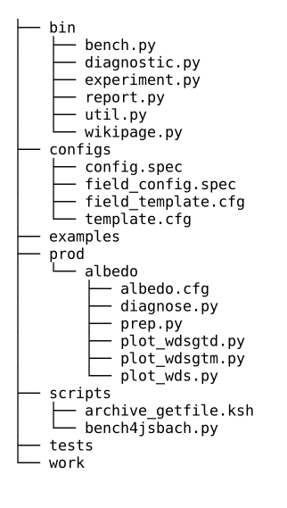
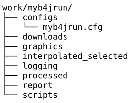
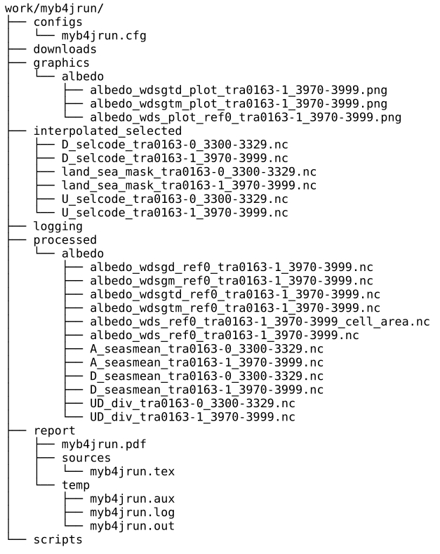

.. include:: defs.hrst

.. _userguide-com:

User guide for benchmarking
===========================

This chapter shall enable you to use |b4j| for the comparison of |exp| s with
predefined |diag-f| s.

Prerequisites
-------------

|b4j| is developed for UNIX and LINUX operating systems. It is written in
object-oriented |py| and works with version 2.7. The packages NumPy and NetCDF4 and the
2D plotting library matplotlib are used which are contained in most scientific
|py| distributions like Anaconda, Miniconda or Canopy. Furthermore |b4j| makes
use of the benchmarking tool |pycmbs| and the climate data command line
operators |cdo|, both inhouse-developments of the Max-Planck-Institute for
Meteorology.

We use Anaconda and can highly recommand it, as it simplifies
package management and deployment, see 
http://conda.pydata.org/docs/_downloads/conda-cheatsheet.pdf. From here on
it is refered to in the installation process.

Make sure that your system uses |py| from :math:`\mathtt{opt/anaconda/bin}`
with :math:`\mathtt{opt}` being your Anaconda base directory.
If necessary, download and install Anaconda, you can get it from 
http://docs.continuum.io/anaconda/install#linux-install, and put
:math:`\mathtt{opt/anaconda/bin}` to your system PATH.
Then update and install the necessary |py| packages,  ..

::
   
   >>> conda update conda
   >>> conda update anaconda
   >>> conda install netcdf4
   >>> conda install -c https://conda.binstar.org/scitools cartopy
   >>> conda install geos basemap
   >>> conda install gdal
   
\.. |cdo| \..

::
   
   >>> pip install cdo

\.. and |pycmbs|

::

   >>> cd opt
   >>> git clone https://github.com/pygeo/pycmbs
   >>> cd pycmbs
   >>> env OMP_NUM_THREADS=1 python setup.py install

Get |b4j|
---------

Change to the root directory of your local |jsbach|
repository git@git.mpimet.mpg.de:jsbach.git, that is the one
containing the :math:`\mathtt{.git}`
directory. If you do not have the repository get it with

::

   >>> git clone git@git.mpimet.mpg.de:jsbach.git

Therefore you need passwordless ssh and the access permission for the git server
(contact reiner.schnur@mpimet.mpg.de). Switch to the git branch :math:`\mathtt{jsbach-dkl}`

::

   >>> git checkout jsbach-dkl

You will also need passwordless ssh for the servers from which you want to
read experiment data.

Being in the git branch :math:`\mathtt{jsbach-dkl}` you find the files for the
tool  under :math:`\mathtt{git/jsbach/tools/bench4jsbach}` with :math:`\mathtt{git/jsbach}`
as your git root directory. The structure of the |b4j| base directory
:math:`\mathtt{bench4jsbach}` you find initially is shown below.

   **Figure:**  initial structure of :math:`\mathtt{git/jsbach/tools/bench4jsbach}`

The following list describes the individual directories in :math:`\mathtt{bench4jsbach}`. 

:bin:     core source files
:configs: specification and template files for the run configuration
:doc:     Sphinx documentation source files and Makefile
:prod:    scripts and configurations for particular |diag-f| s
:scripts: essential parts of |b4j| e.g. run scripts
:tests:   different testing environments
:work:    currently hardcoded working directory

Prepare a run
-------------

A |b4j| run consists of two parts, the initial startup run which is done once to set up
the environment and create the directory structure and the main run, fetching
expriment data, analysing, making plots and writing a report. Both parts are controled
by the run script :math:`\mathtt{bench4jsbach/scripts/bench4jsbach.py}`.

Initial run
-----------

A |b4j| run needs a name as it writes data to your local filesystem that has to be
addressed. First choose this run name (e.g. :math:`\mathtt{myb4jrun}`) and  change to the
base directory :math:`\mathtt{bench4jsbach}`.
Call the run script :math:`\mathtt{bench4jsbach.py}` with your run name
as command line argument.

::
   
   >>> cd git/jsbach/tools/bench4jsbach
   >>> ./scripts/bench4jsbach.py myb4jrun

While running, the tool writes a welcome and a final success/error message to your display. In
addition the internal debugger prints to standard output in the default setting.

.. literalinclude::  ./graphic/initial-run-output.txt

**Listing:** Standard output after the initial run with argument :math:`\mathtt{myb4jrun}`
		     
When the startup run has finished successfully, the directory structure for
:math:`\mathtt{myb4jrun}` is created (as shown in the figure below) and an
editable, default configuration file :math:`\mathtt{myb4jrun.cfg}` is written
in :math:`\mathtt{myb4jrun/configs}`, also shown further down.

   **Figure:**  Initial structure of :math:`\mathtt{bench4jsbach/work/myb4jrun}`

.. _main-config:

Main configuration file
-----------------------

The generated file is a form for the main configuration of your |b4j| run and has to be
adapted to the planned experiment comparison. It is formatted to be read by a |py| config
file parser after your accomplishment. A config file
consists of key value pairs and sections nested to any depth. For the sections
square brackets are used, indentation clearifies the nesting level. You can write
comments inline prepended by the hash symbol \"#\".

::
   
   key-1=value-1
   key-2=value-2
   [section-1]
      key-1=value-1
      [[subsection-1]]
         key-1=value-1
	   
**Listing:** Basic configuration file supported by a |py| parser

After generation the file :math:`\mathtt{myb4jrun.cfg}` contains the
structure of information that the configuration for a minimum |b4j| run with two
|exp| s (see :ref:`exps`) and one |diag-f| (see :ref:`diag-fs`) has to provide.

In the file :math:`\mathtt{myb4jrun.cfg}`, which is displayed below, the mandatory
fields to be filled in are
marked with angle brackets (<,>) and located in the second part of the file,
below the comment line \"# PLEASE EDIT ...\".  The capital text within is
meant to be explanatory and the whole string including the brackets has to be
exchanged against your value for the respective item.

.. literalinclude::  ./graphic/myb4jrun.cfg
	   
**Listing:** File :math:`\mathtt{myb4jrun.cfg}` after generation, a form for the
main configuration

In the following the values to fill in are summarized.

Top level configuration
+++++++++++++++++++++++

Top level in the main configuration file:

+------------------------------------------------+-----------------------------------+
| key                                            | value                             |
+-----------------+------------------------------+-----------------+-----------------+
| name            | description                  | datatype        | default         |
+=================+==============================+=================+=================+
| redmine_user    | redmine user login name      | string          | None            |
+-----------------+------------------------------+-----------------+-----------------+
| redmine_key     | redmine \"Api access key\"   | string          | None            |
+-----------------+------------------------------+-----------------+-----------------+
| institute       | users' institute             | string          | None            |
+-----------------+------------------------------+-----------------+-----------------+
| department      | users' department            | string          | None            |
+-----------------+------------------------------+-----------------+-----------------+
| reporting       | reporting switch             | boolean         | True            |
+-----------------+------------------------------+-----------------+-----------------+

The redmine access is necessary if reference |exp| metadata shall be retrieved from
the table on the wikipage. When you are logged in you can get your redmine "Api access key"
from the right menu on top of the page:

::

   > My account > API access key > Show

If it does not exist yet, it can easily be created within the same menu.

Experiment section
++++++++++++++++++

The beginning of the section is marked by the header :math:`\mathtt{[experiments]}`. For
each |exp| for comparison in the run there has to be a subsection within, that is
labeled with a run internal unique name.

Single |exp| subsection:

+------------------------------------------------+-----------------------------------+
| key                                            | value                             |
+-----------------+------------------------------+-----------------+-----------------+
| name            | description                  | datatype        | default         |
+=================+==============================+=================+=================+
| name_orig       | |longstring-11|              | string          | \-              |
+-----------------+------------------------------+-----------------+-----------------+
| type            | |exp| type                   | |longstring-12| | MPIESM1         |
+-----------------+------------------------------+-----------------+-----------------+
| path            | |longstring-13|              |                 |                 |
|                 +------------------------------+-----------------+-----------------+
|                 | |longstring-14|              | string          | None            |
+-----------------+------------------------------+-----------------+-----------------+
| host            | |longstring-13|              |                 |                 |
|                 +------------------------------+-----------------+-----------------+
|                 | host of |exp|                | string          | None            |
+-----------------+------------------------------+-----------------+-----------------+
| iscan           | candidate role               | boolean         | \-              |
+-----------------+------------------------------+-----------------+-----------------+
| isref           | reference role               | boolean         | \-              |
+-----------------+------------------------------+-----------------+-----------------+
| startyear       | |longstring-15|              | string          | \-              |
+-----------------+------------------------------+-----------------+-----------------+
| endyear         | |longstring-16|              | string          | \-              |
+-----------------+------------------------------+-----------------+-----------------+
| initialyear     | initial year of |exp|        | string          | None            |
+-----------------+------------------------------+-----------------+-----------------+
| finalyear       | final year of |exp|          | string          | None            |
+-----------------+------------------------------+-----------------+-----------------+

.. |longstring-11| replace:: original identifying infix, e.g. \"vga0187\"
.. |longstring-12| replace:: option (CMPI5, MPIESM1)
.. |longstring-13| replace:: None if item in database
.. |longstring-14| replace:: path of |exp| in filesystem on host  
.. |longstring-15| replace:: startyear for |exp| in |b4j| run  
.. |longstring-16| replace:: endyear for |exp| in |b4j| run  

.. _diag-f-section:

Diagnostic field section
++++++++++++++++++++++++

The beginning of the section is marked by the header :math:`\mathtt{[fields]}`.
For each |diag-f| in the run has to be a subsection inside, that is labeled with a
run internal unique name.

Single |diag-f| subsection:

+------------------------------------------------+-----------------------------------+
| key                                            | value                             |
+-----------------+------------------------------+-----------------+-----------------+
| name            | description                  | datatype        | default         |
+=================+==============================+=================+=================+
| config_filename |  |longstring-17|             | string          | \-              |
|                 +------------------------------+                 |                 |
|                 |  |longstring-18|             |                 |                 |
+-----------------+------------------------------+-----------------+-----------------+

.. |longstring-17| replace:: |diag-f| configuration filename in :math:`\mathtt{bench4jsbach/prod/configs}`
.. |longstring-18| replace:: path to |diag-f| configuration file in local filesystem

Files in context with the available |diag-f| s are stored in
:math:`\mathtt{bench4jsbach/prod}`, the configuration files beneath in
the directory :math:`\mathtt{configs}`. A list of available |diag-f| s can be
found under :ref:`diag-f-avail`.

When you have replaced all placeholders \"<XXX>\" with the appropriate values the
bottom part of your configuration file should look in principle like the example
below.

.. literalinclude::  ./graphic/myb4jrun-filled.cfg
	   
**Listing:** Extract of example configuration file :math:`\mathtt{myb4jrun.cfg}`

Run example myb4jrun
--------------------

The run can now be started.

::
   
   >>> ./scripts/bench4jsbach.py work/myb4jrun/myb4jrun.cfg

The CPU time maybe about one minute but, as it depends on the duration of the
data fetching process, also more. 

   **Figure:**  After the run, structure of :math:`\mathtt{bench4jsbach/work/myb4jrun}`

The generated report :math:`\mathtt{myb4jrun.pdf}` can be found in
:math:`\mathtt{myb4jrun/report}`, LaTeX source
and temporary files are kept in subdirectories, the graphics included in the report
are in a parallel 
directory :math:`\mathtt{myb4jrun/graphics}`. If you want to have a closer look on
the diagnostics made, you find the results of the calculations and also the
intermediate, preprocessed and downloaded data in the directories 
:math:`\mathtt{downloads}`,  :math:`\mathtt{interpolated\_selected}` respectively
:math:`\mathtt{processed}`.

.. rubric:: References

.. [GiESM1] Giorgetta, M., et al.: Climate and carbon cycle changes from 1850 to 2100 in MPI-ESM simulations for the coupled model intercomparison project phase 5. Journal of Advances in Modeling Earth Systems, 5, 572-597 , 2013, doi:10.1002/jame.20038
.. [ReJSBA] Reick, C., et al.: Representation of natural and anthropogenic land cover change in MPI-ESM. Journal of Advances in Modeling Earth Systems, 5, 459-482 , 2013, doi:10.1002/jame.20022
