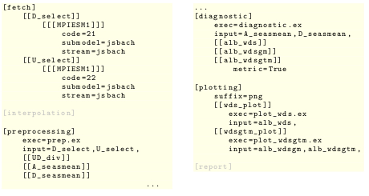

.. include:: defs.hrst

User guide for developing diagnostic fields
===========================================

In the following we show how a diagnostic for |exp| comparison from
external sources can be prepared to serve as |diag-f| that may be triggered by
a |b4j| run. A |diag-f| consists of 
scripts for the processing chain (preprocessing, analysing, plotting), declarations
also for data retrieval and interpolation, descriptive textblocks for generating reports
and a configuration file to concentrate the setup. The scripts may be
written in any programming language that is supported by your platform.
A script has to be layed out for one candidate and one reference
so that it is scalable, i.e. it can be called in loops over multiple |exp| s. It
will work on local data which the tool has selected and interpolated
from the |exp| output beforehand as
it had been indicated by the user and the |exp| type. The
interface of each script has to be declared in a respective section of the
|diag-f| s' configuration file. The
information to provide include input and output filenames and possibly hints
on format, grid,
spatial resolution, tiling and global fragmentation and time resolution and
period. 

We use the example :math:`\mathtt{myb4jrun}` from the
last section :ref:`userguide-com` again.
In the run we want to include some
diagnostic and benchmarking for a clear cut out example scientific issue called
:math:`\mathtt{myfield}`.

Declaration in main configuration
---------------------------------
      
The central entry point for a
|diag-f| into the run is its :ref:`diag-f-section` in the main
configuration file, in this example :math:`\mathtt{myb4jrun.cfg}`. We declare a subsection
called :math:`\mathtt{myfield}` and fill in the path to a new field configuration file
as value for the key :math:`\mathtt{config\_filename}`, here
:math:`\mathtt{mypath/myfield.cfg}`.

.. literalinclude::  ./graphic/mydiagfield.cfg
	   
**Listing:** Declaration of :math:`\mathtt{myfield}` in main configuration file :math:`\mathtt{myb4jrun.cfg}`

Configuration file myfield.cfg
------------------------------

In this chapter we explain in detail how to develop the field configuration
file. The file has to contain all the settings and
communication parameters that are needed for a |diag-f|, from fetching |exp| output
data until writing the benchmark results in a final report.

Top level configuration
+++++++++++++++++++++++

Top level in the |diag-f| configuration file:
      
+------------------------------------------------+-----------------------------------+
| key                                            | value                             |
+-----------------+------------------------------+-----------------+-----------------+
| name            | description                  | datatype        | default         |
+=================+==============================+=================+=================+
| field_name      | |longstring-21|              | string          | \-              |
+-----------------+------------------------------+-----------------+-----------------+
| suffix          | |longstring-22|              | string          | \-              |
+-----------------+------------------------------+-----------------+-----------------+
| frequency       | |longstring-23|              | |longstring-24| | monthly         |
+-----------------+------------------------------+-----------------+-----------------+
| documentation   | |longstring-25|              | string          | None            |
+-----------------+------------------------------+-----------------+-----------------+

.. |longstring-21| replace:: field id conform to id/name of diagnostic field in main configuration
.. |longstring-22| replace:: output format suffix for processed data of the run
.. |longstring-23| replace:: output frequence to use in the run
.. |longstring-24| replace:: option (yearly, monthly, 6-hourly)
.. |longstring-25| replace:: self documentation

For verification it will be checked if the value for the key
:math:`\mathtt{field\_name}` is consistent with the name given for the
:math:`\mathtt{field}` in the main configuration.
			    

In our example we fill in the respective values.

::

   field_name=myfield
   suffix=nc
   frequence=monthly
   documentation="""
   NAME 
	   myfield_diagnostic

   DESCRIPTION
	   This configuration ...

   DETAILS
	   For all experiments ...
	   """
	   
**Listing:** Example :math:`\mathtt{myfield.cfg}`, top level configuration

Processing chain
++++++++++++++++

The processes involved in a |diag-f| are
interconnected by I/O dependencies. For the time being they have a binding
order: 1. :math:`\mathtt{fetch}`,
2. :math:`\mathtt{interpolate}`, 3. :math:`\mathtt{preprocess}`,
4. :math:`\mathtt{diagnose}`, 5. :math:`\mathtt{plot}`. |b4j| works internally
with an indexing system in which files are addressed by unique infixes,
f.e. :math:`\mathtt{VARNAME-INFIX}`.  For each
file that shall be written by a process, the appropriate section has to hold a
subsection :math:`\mathtt{[[VARNAME-INFIX]]}`
which contains the detailed configuration. The infix
will also be used as substring for the corresponding filename. If the file
shall be read by a subsequent process, it has to be appended to the respective 
:math:`\mathtt{input}` list. For illustration  
the listing :ref:`io-dependencies-html` at the bottom of the page shows a detail
from the configuration file for the
|diag-f| :math:`\mathtt{myfield}`. In HTML the graphic serves also as a link to
another picture,
showing how the I/O dependencies are taken into account.

Fetch section
+++++++++++++

The beginning of the section is marked by the header :math:`\mathtt{[fetch]}`.
For each variable that the |diag-f| requires from the |exp| output the |b4j| run will
write a file containing the selected data field. You have to define a subsection f.e.
:math:`\mathtt{[[VARNAME-INFIX]]}` for it.

A single subsection in section  :math:`\mathtt{fetch}` contains the following key:value
entries:

+------------------------------------------------+-----------------------------------+
| key                                            | value                             |
+-----------------+------------------------------+-----------------+-----------------+
| name            | description                  | datatype        | default         |
+=================+==============================+=================+=================+
| longname        | complete name                | string          | None            |
+-----------------+------------------------------+-----------------+-----------------+
| unit            | physical unit                | string          | \-              |
+-----------------+------------------------------+-----------------+-----------------+

Inside there has to be one subsubsection for each
:math:`\mathtt{experiment\_type}` given
for any item in the |exp| section of the main configuration. This subsubsection must be
labelled with the respective  :math:`\mathtt{type}` name.

Subsubsection for the  :math:`\mathtt{experiment\ type}` :math:`\mathtt{MPIESM1}`:

+------------------------------------------------+-----------------------------------+
| key                                            | value                             |
+-----------------+------------------------------+-----------------+-----------------+
| name            | description                  | datatype        | default         |
+=================+==============================+=================+=================+
| name            | |longstring-26|              | string          | \-              |
+-----------------+------------------------------+-----------------+-----------------+
| code            | |longstring-27|              | string          | \-              |
+-----------------+------------------------------+-----------------+-----------------+
| submodel        | |longstring-28|              | string          | \-              |
+-----------------+------------------------------+-----------------+-----------------+
| stream          | |longstring-29|              | string          | \-              |
+-----------------+------------------------------+-----------------+-----------------+

.. |longstring-26| replace:: name of variable to select
.. |longstring-27| replace:: code number of variable to select 
.. |longstring-28| replace:: submodel identifier in the original context
.. |longstring-29| replace:: stream identifier in the original context

			      
For clarification we show  one variable subsection labelled
:math:`\mathtt{D\_selcode}`  of the :math:`\mathtt{fetch}` section from
our example :math:`\mathtt{mypath/myfield.cfg}`.

::

   [fetch]
       [[D_selcode]]
	   longname=Surface Downwelling Solar Radiation [W m-2]
	   unit=Wm**(-2)
	   [[[MPIESM1]]]
	       name=swdown_acc
	       code=21
	       submodel=jsbach
	       stream=jsbach
	       
**Listing:** Example :math:`\mathtt{fetch}` section configuration

Processing sections
+++++++++++++++++++

In order to do the preprocessing, diagnostic and plotting |b4j| calls the
executable script given for the key :math:`\mathtt{exec}` in the respective
section. In the standard case the tool would look in
:math:`\mathtt{bench4jsbach/prod/scripts}` for it but you may just as well
provide
another path. We choose again :math:`\mathtt{mypath}` as path for the executable
scripts in the example below, without limiting the generality.

Preprocessing and diagnostic sections
+++++++++++++++++++++++++++++++++++++

Top level in the :math:`\mathtt{preprocessing}` and  the
:math:`\mathtt{diagnostic}` sections:

+------------------------------------------------+-----------------------------------+
| key                                            | value                             |
+-----------------+------------------------------+-----------------+-----------------+
| name            | description                  | datatype        | default         |
+=================+==============================+=================+=================+
| exec            | |longstring-30|              | string          | \-              |
+-----------------+------------------------------+-----------------+-----------------+
| input           | |longstring-31|              | stringlist      | \-              |
+-----------------+------------------------------+-----------------+-----------------+

.. |longstring-30| replace:: executable script to call in |b4j| run
.. |longstring-31| replace:: input files needed by script

In the example below the script :math:`\mathtt{myfield\_prep.py}`
shall do the :math:`\mathtt{preprocessing}`.  It has to read a data file
that ought to be found during the |b4j| run by the identifier :math:`\mathtt{D\_selcode}`
as it is given in the value list of the key :math:`\mathtt{input}`. It shall store
intermediate
results in an output file that can be indexed by
:math:`\mathtt{D\_seasmean}` . This is indicated by the appropriatly labelled subsection.

::
   
   [preprocessing]
       exec=mypath/myfield_prep.py
       input=D_selcode,
       [[D_seasmean]]
	       
**Listing:** Example :math:`\mathtt{preprocessing}` section configuration

Plotting section
++++++++++++++++

For the plotting we allow several scripts, the section was adjusted to this requirement.

Top level of the :math:`\mathtt{plotting}` section:

+------------------------------------------------+-----------------------------------+
| key                                            | value                             |
+-----------------+------------------------------+-----------------+-----------------+
| name            | description                  | datatype        | default         |
+=================+==============================+=================+=================+
| suffix          | output format string         | string          | \-              |
+-----------------+------------------------------+-----------------+-----------------+

There are subsections for one or more plotting scripts labelled with a unique identifier
for the particular script.

Single plotting script subsection:

+------------------------------------------------+-----------------------------------+
| key                                            | value                             |
+-----------------+------------------------------+-----------------+-----------------+
| name            | description                  | datatype        | default         |
+=================+==============================+=================+=================+
| exec            | |longstring-30|              | string          | \-              |
+-----------------+------------------------------+-----------------+-----------------+
| input           | |longstring-31|              | stringlist      | \-              |
+-----------------+------------------------------+-----------------+-----------------+
| nref            | |longstring-32|              | |longstring-33| | \-              |
+-----------------+------------------------------+-----------------+-----------------+
| plot\_title     | |longstring-34|              | stringlist      | \-              |
+-----------------+------------------------------+-----------------+-----------------+

.. |longstring-32| replace:: as indicated by plot: comparison with single or all reference experiment
.. |longstring-33| replace:: option (single, multiple)
.. |longstring-34| replace:: title string for plot

As in the other processing sections output files are introduced by labelled subsections beneath. In
the example below the subsection :math:`\mathtt{wds\_plot}` indicates plotting with the script
:math:`\mathtt{myfield\_wds\_plot.py}`. According to the value :math:`\mathtt{single}` for the
key :math:`\mathtt{nref}` the script will run seperatly for each candidate, reference |exp| pair.
It shall read a file indexed by :math:`\mathtt{myfield\_wds}` which has to be written
by a predecessor process. For each pair it is supposed to store a plot output file
with the format :math:`\mathtt{png}` and a title generated from the output infix
:math:`\mathtt{myfield\_wds\_plot}`. For the plots the :math:`\mathtt{plot\_title}` has to be
used, here consisting of a template and parameters, which should be expanded by the script.

::
   
   [plotting]
       suffix=png	
       [[wds_plot]]
	   exec=myfield_wds_plot.py
	   input=myfield_wds,
	   nref=single
	   plot_title='$\Delta_{C_{\%d}R_{\%d}}$',can_no,ref_no,
    	   [[[myfield_wds_plot]]]
	       
**Listing:** Example :math:`\mathtt{plotting}` section configuration

.. _io-dependencies-html:

I/O dependencies
++++++++++++++++

The listing below shows an extract of the example |diag-f| configuration file
:math:`\mathtt{myfield.cfg}`. In HTML the listing is also a link to an illustration
of the processing chain formed by I/O dependencies. In the example the file
indexed :math:`\mathtt{wds\_plot}` being output of the plotting process is the end of
a chain, started with the file :math:`\mathtt{D\_select}` which shall contain
|exp| output data selected by the |b4j| run.

**Figure:** Example :math:`\mathtt{myfield.cfg}` (HTML link)

.. only:: latex

	  .. figure::  ./graphic/diagfield-conf-overlay.jpg

	  **Figure:**
		       Highlighted I/O dependency chain for 
		       :math:`\mathtt{wds\_plot}` indexed plot file
	  
Report section
++++++++++++++

The report section is arranged at the end of the configuration file to improve
readabiliy.

Top level in the :math:`\mathtt{report}` section:

+------------------------------------------------+-----------------------------------+
| key                                            | value                             |
+-----------------+------------------------------+-----------------+-----------------+
| name            | description                  | datatype        | default         |
+=================+==============================+=================+=================+
| title           | |longstring-35|              | string          | \-              |
+-----------------+------------------------------+-----------------+-----------------+
| abstract        | |longstring-36|              | string          | \-              |
+-----------------+------------------------------+-----------------+-----------------+
| technical_TeXed | |longstring-37|              | string          | \-              |
+-----------------+------------------------------+-----------------+-----------------+

.. |longstring-35| replace:: title for the |diag-f| 's section in the report
.. |longstring-36| replace:: scientific description of the |diag-f|
.. |longstring-37| replace:: technical description of the |diag-f|

There have to be subsections for each diagnostic result to appear in the report. For the
time being the mapping is based on the conformity with the output file infixes of
the :math:`\mathtt{diagnostic}` section.

Subsections refering to  :math:`\mathtt{diagnostic}` output:

+------------------------------------------------+-----------------------------------+
| key                                            | value                             |
+-----------------+------------------------------+-----------------+-----------------+
| name            | description                  | datatype        | default         |
+=================+==============================+=================+=================+
| title           | |longstring-38|              | string          | \-              |
+-----------------+------------------------------+-----------------+-----------------+
| abstract        | |longstring-39|              | string          | \-              |
+-----------------+------------------------------+-----------------+-----------------+
| technical_TeXed | |longstring-40|              | string          | \-              |
+-----------------+------------------------------+-----------------+-----------------+
| name            | |longstring-41|              | string          | \-              |
+-----------------+------------------------------+-----------------+-----------------+
| isbench         | |longstring-42|              | boolean         | \-              |
+-----------------+------------------------------+-----------------+-----------------+
| benchvar        | |longstring-43|              | string          | \-              |
+-----------------+------------------------------+-----------------+-----------------+
| benchunit       | |longstring-44|              | string          | \-              |
+-----------------+------------------------------+-----------------+-----------------+
| type            | |longstring-45|              | |longstring-46| | \-              |
+-----------------+------------------------------+-----------------+-----------------+

.. |longstring-38| replace:: title of report subsection
.. |longstring-39| replace:: scientific description of diagnostic method
.. |longstring-40| replace:: technical description of diagnostic method 
.. |longstring-41| replace:: name of diagnostic method
.. |longstring-42| replace:: switch: Is diagnostic method used as benchmark?
.. |longstring-43| replace:: name of displayed variable in plotfile
.. |longstring-44| replace:: physical unit of displayed variable
.. |longstring-45| replace:: type of plot
.. |longstring-46| replace:: option (map, metric, barchart)

Processing scripts
------------------

The processing scripts ( for preprocessing, diagnostic and plotting ) are run as |py|
subprocesses. A string list is passed as argument. Each element has the format

::

   "XXX:YYYY"

with "XXX" being a key out of the main or the |diag-f| configuration and "YYY" the
corresponding value. The informtion that should be provided include

  
* attributes of the candidate |exp|
  
* attributes of the reference |exp|
  
* paths to input files
  
* paths to output files

The processes have to parse this string list at runtime to get the keyword arguments.
